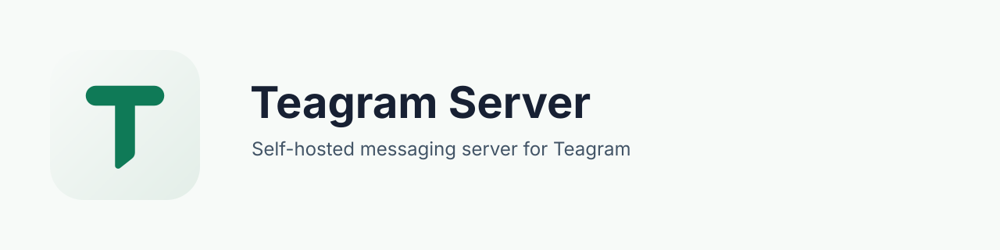
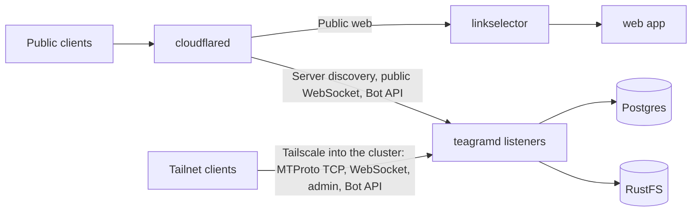

<picture>
  <source media="(prefers-color-scheme: dark)" srcset="docs/assets/banner-dark.svg">
  <source media="(prefers-color-scheme: light)" srcset="docs/assets/banner-light.svg">
  
</picture>

# Teagram Server

Teagram Server is a Go MTProto server for Teagram clients, with Postgres-backed
accounts and messages, media storage, and an admin metrics dashboard. The live
instance is used for development and has no real users. Teagram is an
independent project and is not affiliated with Telegram.

Teagram is software. Its authors hold no liability for what operators or users
do with a self-hosted Teagram instance. Each instance's operator and its users
are responsible for the content on that instance, including sticker and emoji
packs users import.

To run a server on your own Linux host, follow the
[self-hosting guide](docs/self-hosting.md).

[](https://github.com/teagramhq/teagram-server/actions/workflows/ci.yml)

Required checks on `main`: `ci`, `pr-title`, `real-client-browser-flow`, and
`merge-gate`.

## Features

- Username and password sign-in, operator-issued registration invites, and
  user-issued invite links with a weekly quota.
- Direct messages, group chats, channels, polls, reactions, search, dialog
  filters, cloud drafts, unread marks, and a configurable welcome channel.
- Bot accounts, bot tokens, Bot API message sending, and update delivery.
- Photo and document uploads, sticker sets, sticker import, and custom emoji.
- HTTPS client discovery and public WebSocket connections; the web demo can
  enforce a browser-only WebSocket policy.
- An admin metrics dashboard and performance-at-scale checks.

## Sign-in

Accounts use a username and password. Phone login is out of scope. Teagram
clients do not sign in by phone or QR.

## Local development

Use Docker Compose for local dependencies, or start Postgres separately and
run the server with:

```sh
make migrate build run
```

Provide `TG_POSTGRES_DSN`, a server RSA identity, and an auth-key master key
for a direct local run. Production registration is configured separately; the
public listener uses invite registration.

## Configuration

Configuration is read from environment variables. The full reference is in
[docs/configuration.md](docs/configuration.md).

| Area | Essential settings | Purpose |
|---|---|---|
| Connection | `TG_POSTGRES_DSN`, `TG_ADVERTISE_ADDR` | Postgres and the address advertised to clients |
| Keys | `TG_RSA_KEY_PATH`, `TG_AUTHKEY_ENC_KEY` or `TG_AUTHKEY_ENC_KEY_FILE` | Server identity and auth-key encryption |
| Listeners | `TG_LISTEN_ADDR`, `TG_WEBSOCKET_LISTEN_ADDR`, `TG_PUBLIC_WEBSOCKET_LISTEN_ADDR`, `TG_BOT_API_LISTEN_ADDR`, `TG_ADMIN_LISTEN_ADDR` | MTProto, WebSocket, Bot API, and admin endpoints |
| Registration | `TG_REGISTRATION`, `TG_PUBLIC_REGISTRATION` | Account sign-up policy; production public WebSocket registration is configured as invite-only |
| Public links | `TG_PUBLIC_LINK_PREFIX`, `TG_INVITE_WEB_SIGNUP_URL`, `TG_INVITE_DESKTOP_URL` | Client, discovery, and invite landing links |
| Media | `TG_BLOB_DIR`, `TG_BLOB_S3_*` | Local media storage or an S3-compatible backend; production points the S3 endpoint at RustFS |

## Architecture



Postgres stores accounts, messages, and metadata. RustFS stores production media
bodies through the S3-compatible backend.

## Deployment

Production runs on a single-node k3s cluster. The `Deploy.` workflow deploys
each green `main` commit. See the
[k3s operations guide](deploy/k8s/README.md) and the
[`Deploy.` workflow](.github/workflows/deploy.yml) for deployment and recovery
details.

## Documentation

| Path | Contents |
|---|---|
| [docs/clients.md](docs/clients.md) | Client connections, discovery, enrollment, and sign-in |
| [docs/configuration.md](docs/configuration.md) | Complete `teagramd` environment variable reference |
| [docs/self-hosting.md](docs/self-hosting.md) | Single-host self-hosting guide |
| [docs/catalog.md](docs/catalog.md) | Catalog and RPC support reference |
| [docs/sticker-bundles.md](docs/sticker-bundles.md) | Sticker and custom emoji catalog bundles |
| [docs/media-storage-threat-model.md](docs/media-storage-threat-model.md) | Media storage, deletion, and retention controls |
| [docs/observability.md](docs/observability.md) | Admin metrics and operational observability |
| [docs/postgres-stats-review.md](docs/postgres-stats-review.md) | PostgreSQL statistics review |
| [docs/sql-query-lint.md](docs/sql-query-lint.md) | SQL query linting |
| [docs/pollprobe.md](docs/pollprobe.md) | Polling and update-delivery probe |
| [docs/security.md](docs/security.md) | Security model and controls |
| [docs/public-websocket-threat-model.md](docs/public-websocket-threat-model.md) | Public WebSocket ingress, authentication, and abuse controls |
| [docs/migrations.md](docs/migrations.md) | Atlas migration workflow |
| [docs/testing.md](docs/testing.md) | Test harness and local test workflow |
| [deploy/k8s/README.md](deploy/k8s/README.md) | Production deployment, ingress, backups, and recovery |
| [deploy/k8s/identity-threat-model.md](deploy/k8s/identity-threat-model.md) | Server identity custody, access, backup, restore, and replacement |
| [deploy/teagram-demo/README.md](deploy/teagram-demo/README.md) | Web demo deployment and its operational controls |
| [ROADMAP.md](ROADMAP.md) | Current capabilities, deployment status, and known limitations |

## Build

The server requires Go 1.27.4. Docker is used for the Postgres test harness;
Compose, Atlas, and `golangci-lint` are used by local development and CI.
`make build`, `make test`, and `make lint` are the standard project commands.
The full test suite runs in CI.

## License and attribution

Teagram Server is licensed under the GNU Affero General Public License v3.0 or
later; see [LICENSE](LICENSE). It uses the exported packages from
[gotd](https://github.com/gotd/td) for MTProto support.
